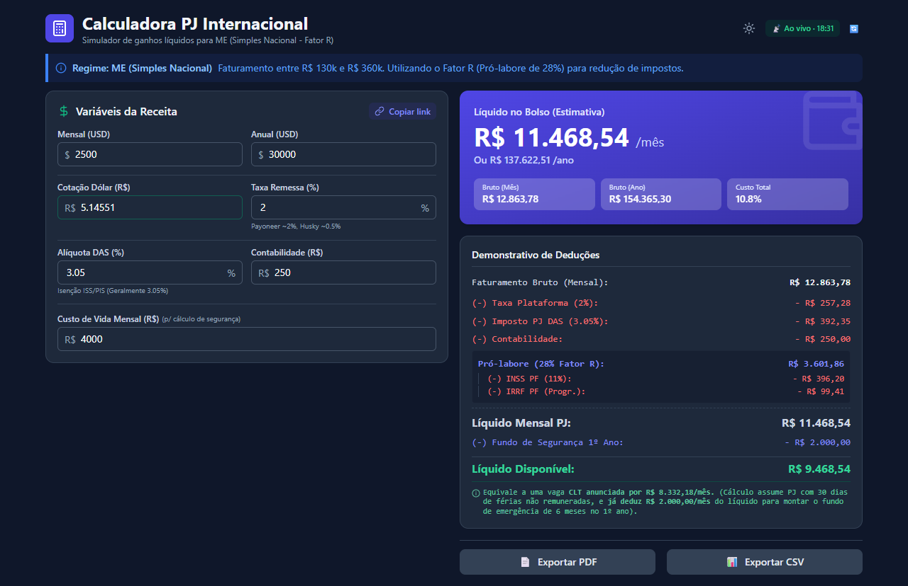
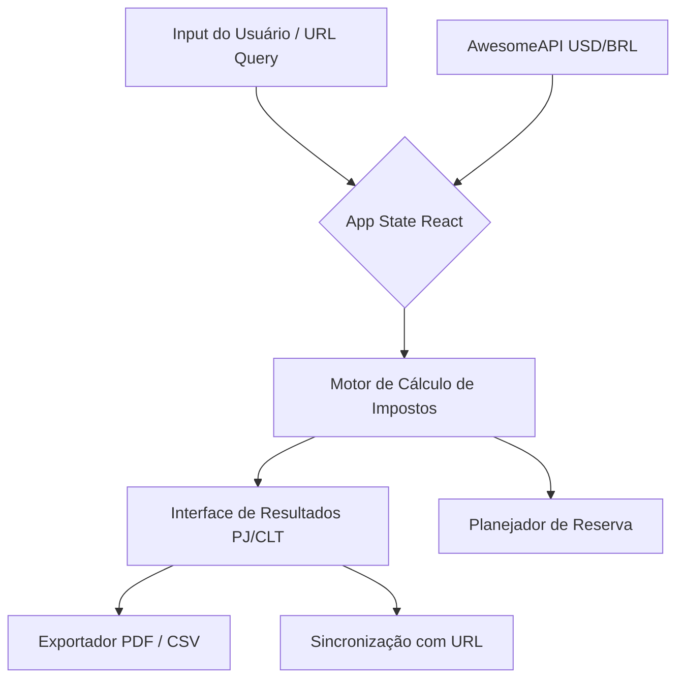

# Calculadora PJ Internacional

[](https://github.com/victormends/calculadora-pj-internacional/actions/workflows/ci.yml)
[](https://github.com/victormends/calculadora-pj-internacional/actions/workflows/deploy.yml)
[](https://opensource.org/licenses/MIT)

Uma calculadora simples e direta para desenvolvedores brasileiros que trabalham como Pessoa Jurídica (PJ) para o exterior. Calcula impostos (DAS, IRRF, INSS) e taxas (remessa, contabilidade) a partir de um salário em Dólar (USD).

> **Aviso:** Esta ferramenta tem caráter exclusivamente informativo e educacional para estimativas rápidas; não substitui orientação contábil, fiscal ou jurídica profissional.

🌐 **[Acessar a Calculadora Online](https://victormends.github.io/calculadora-pj-internacional/)**



## ✨ Features Principais

- **Cotação em Tempo Real:** Obtém o valor do Dólar ao vivo via [AwesomeAPI](https://docs.awesomeapi.com.br/api-de-moedas) para garantir precisão no cálculo.
- **Comparação de Cenários:** Exibe o salário líquido categorizando a empresa em MEI, ME, EPP ou OUT (Lucro Presumido/Real) para fácil comparação.
- **Planejador de Reserva:** Conta com uma aba dedicada para calcular e planejar sua reserva de emergência baseada nos seus custos.
- **Exportação de Dados:** Permite baixar a simulação final em **PDF** ou **CSV** para controle financeiro.
- **Dark Mode:** Suporte nativo a tema escuro (TailwindCSS), adaptando-se às preferências do sistema operacional.
- **Compartilhamento (Stateful URL):** Salva o estado da simulação diretamente na URL.

## 🔗 Compartilhamento via URL

A calculadora hidrata automaticamente todos os campos a partir da query string, permitindo que você salve simulações ou compartilhe com outros devs. Parâmetros aceitos:

- `usd`: Salário em USD (ex: 5000)
- `rate`: Taxa de câmbio (ex: 5.25)
- `fee`: Taxa de remessa em % (ex: 1.2)
- `das`: Alíquota do Simples/DAS em % (ex: 6.0)
- `acc`: Custo mensal da contabilidade (ex: 200)
- `lc`: Custo mensal de vida / Living Cost (ex: 3000)

**Exemplo:** `?usd=5000&rate=5.50&fee=1&das=6&acc=300&lc=3000`

## 🏗️ Arquitetura e Fluxo de Dados

A aplicação foi construída para rodar totalmente no lado do cliente (Client-Side), sem armazenamento de dados sensíveis em banco de dados.



## 🛠️ Stack

- **React + TypeScript:** Base tipada e reativa.
- **Vite:** Bundler ultrarrápido para desenvolvimento.
- **Tailwind CSS:** Estilização utilitária ágil.
- **Vitest + Happy DOM:** Testes unitários focados em lógica e renderização.
- **jsPDF + jsPDF-AutoTable:** Geração de relatórios PDF locais.

## 🚀 Setup Local

```bash
# Instalar dependências
npm install

# Rodar os testes
npm test

# Executar em modo de desenvolvimento
npm run dev

# Fazer o build de produção
npm run build
```

## 📚 Transparência e Bases de Cálculo

Para garantir total transparência sobre como a calculadora chega aos valores líquidos, aqui estão as regras de negócio e alíquotas fixadas no código (`src/utils/taxCalc.ts`), atualizadas com a legislação vigente de 2025/2026:

> **Limitação principal para rendas altas (Lei 15.270/2025):** a retenção de 10% sobre distribuição de lucros e dividendos acima de R$ 50.000/mês por fonte pagadora e o imposto mínimo anual (IRPFM) para rendas totais acima de R$ 600.000/ano (patamar atingido por desenvolvedores a partir de ~US$ 10k/mês) não são modelados em `src/utils/taxCalc.ts`.

- **Teto de Enquadramento:** MEI mantido no limite oficial vigente de **R$ 81.000**. ME (R$ 360k) e EPP (R$ 4.8M).
- **Fator R (Simples Nacional - Anexo III/V):** A calculadora assume o uso automático do Fator R, fixando o **Pró-Labore em 28%** do faturamento bruto mensal para garantir tributação no Anexo III (a partir de 6%) em vez do Anexo V.
- **INSS PF (Sócio-Administrador):** Retenção de **11%** sobre o Pró-Labore, limitada ao **teto oficial do INSS de 2026** (Portaria MPS/MF nº 13/2026: R$ 8.475,55, teto de contribuição de R$ 932,31/mês).
- **IRRF (Imposto de Renda PF):** Utiliza a Tabela Progressiva Atualizada (MP 1.294/2025), cujo teto da primeira faixa (alíquota 0%) é R$ 2.428,80 e que, somado ao desconto simplificado mensal de R$ 607,20 da própria MP, resulta em isenção efetiva de até R$ 3.036,00. Sobre essa base, a calculadora aplica rigorosamente o redutor adicional da Lei 15.270/2025, zerando o IRRF para rendimentos tributáveis de até R$ 5.000,00 e aplicando redução proporcional até R$ 7.350,00.
- **Cálculo CLT Equivalente:** Assume um cenário realista (PJ 11 meses de receita vs CLT 13,33 salários + FGTS + R$ 1k de benefícios).

**Última revisão das tabelas tributárias:** 2026-11-24

## ⚠️ Aviso Legal (Disclaimer)

Esta é uma ferramenta de estimativa criada de desenvolvedor para desenvolvedor. Embora a lógica de cálculo siga a legislação tributária brasileira descrita acima, **ela não substitui a orientação de um contador profissional**. As regras fiscais podem variar conforme a sua cidade, natureza jurídica (CNAE) e faturamento acumulado. Consulte sempre sua contabilidade antes de tomar decisões financeiras.

## 📄 Licença

[MIT](LICENSE) © 2026 João Victor Mendes
